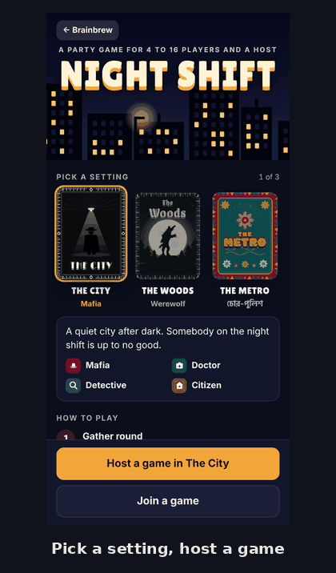
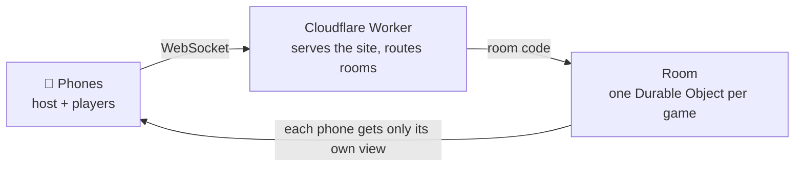
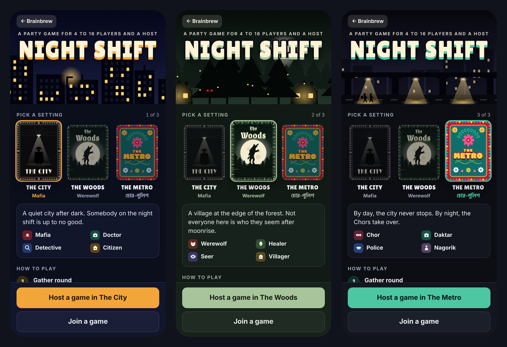
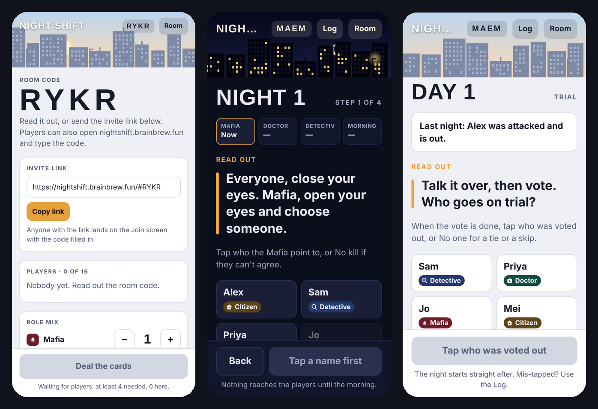
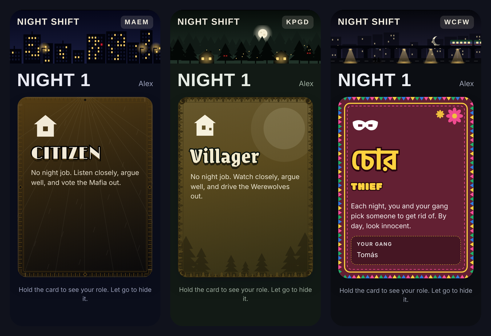
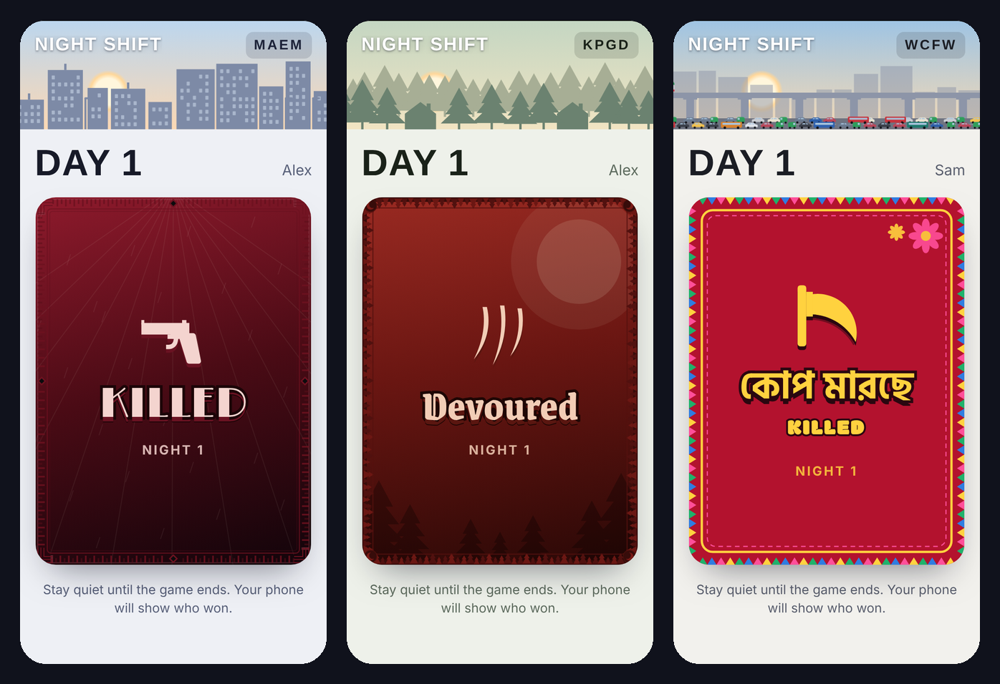

# Night Shift

[](https://github.com/naqvikhan/night-shift-showcase/actions/workflows/test.yml)

**A real-time party game for phones in the Mafia family. The host's phone runs the night, and every player's phone is their secret card.**

▶ **Play it:** [nightshift.brainbrew.fun](https://nightshift.brainbrew.fun) · 4 to 16 players and a host · no app, no sign-up

<p align="center"></p>

This repository is an engineering showcase. It contains the real game engine, room logic, room server and test suite, so you can read the code and run the tests. The phone screens, artwork, the other two settings and the deploy setup are kept private, so this isn't the playable game.

---

## How it works, in one picture



Every room is a tiny server of its own. The phones talk to it over a WebSocket. It keeps the game, decides what each phone may see, and deletes itself 4 hours after the last activity.

## Screenshots



| Host's phone | Role cards | Out cards |
| --- | --- | --- |
|  |  |  |

## What's interesting in the code

- **The whole game is an event log.** `src/engine.js` stores only the dealt roles and a list of events such as kill, save, check, dawn and trial. Every screen is computed by replaying that list, so undo is just shortening the list.
- **Phones can't cheat.** `src/room.js` builds a separate view for each phone, containing only what that player is allowed to know. Other players' roles never reach a player's browser.
- **Out-of-date taps are refused.** Each host command says how long the log was when the host's screen was drawn. If the game has moved on, the command is rejected instead of being applied to the wrong night.
- **One server per room.** `src/index.js` routes each 4-letter room code to its own Cloudflare Durable Object. Rooms use hibernating WebSockets, so a quiet room costs nothing.
- **Built for real phones.** Phones lock and Wi-Fi drops. Each phone keeps a seat token and rejoins the same seat and card, and the host has a recovery code in case their phone dies.
- **Abuse limits.** Guessing room codes is rate-limited per network, other websites can't use the server, and oversized messages are dropped.

There's more on the reasoning in **[docs/DESIGN.md](docs/DESIGN.md)**.

## Run the tests

You need Node 20 or newer. There are no dependencies to install.

```sh
npm test
```

The 15 tests play whole games through the real room code, using fake phones:

- a scripted game from deal to win;
- the Mafia winning when they equal everyone else;
- stale double taps being refused;
- **200 randomly generated games**, undone at random points, with every phone's screen checked to be restored exactly;
- a phone that drops getting the same seat and card back;
- host recovery and its rate limit;
- handing over hosting;
- closing a room and sending everyone home.

## What's in this repo

```
src/
  engine.js     the rules: dealing, the event log, replay, night steps, win check
  room.js       RoomCore: seats, lobby, host commands, per-phone views
  index.js      Cloudflare Worker routes, the Room and Limiter Durable Objects
  themes.js     the wording for The City (the other two settings are private)
test/
  play.test.mjs plays full games through RoomCore
docs/
  DESIGN.md     the main design decisions, simplified
```

**Not included:** the phone UI and all artwork, The Woods and The Metro settings, the in-browser simulator, the site build, and the deployment configuration.

## Built with

Vanilla JavaScript (ES modules), Cloudflare Workers, Durable Objects (SQLite-backed), WebSockets with the Hibernation API, `node:test`, and GitHub Actions.

## License

© 2026 naqvikhan. All rights reserved. Shared as a portfolio piece: you're welcome to read the code and run the tests, but it may not be copied, reused or redistributed. See [LICENSE](LICENSE).
